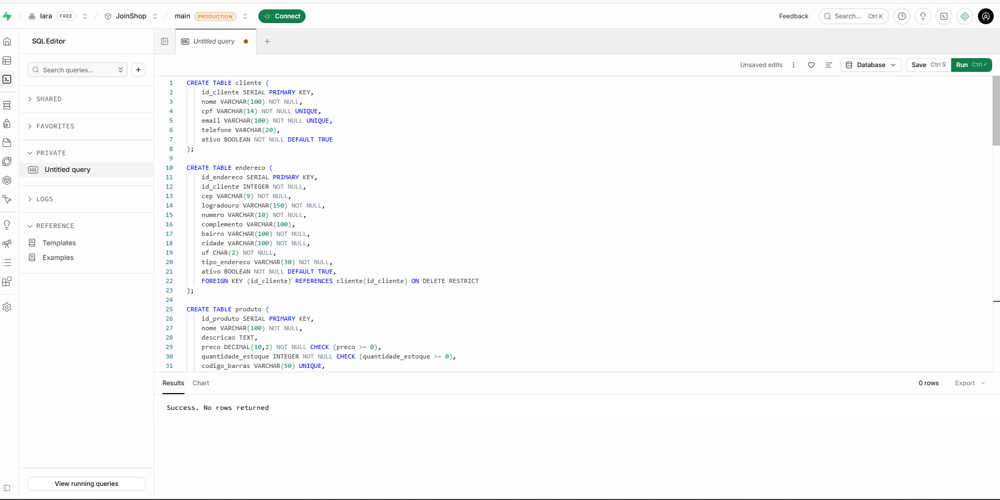
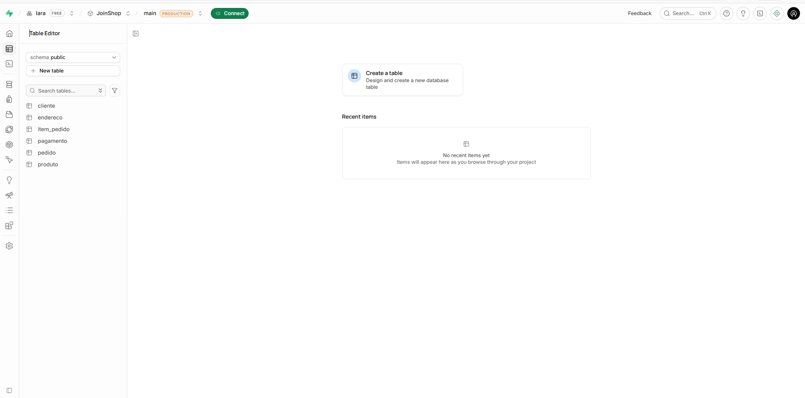
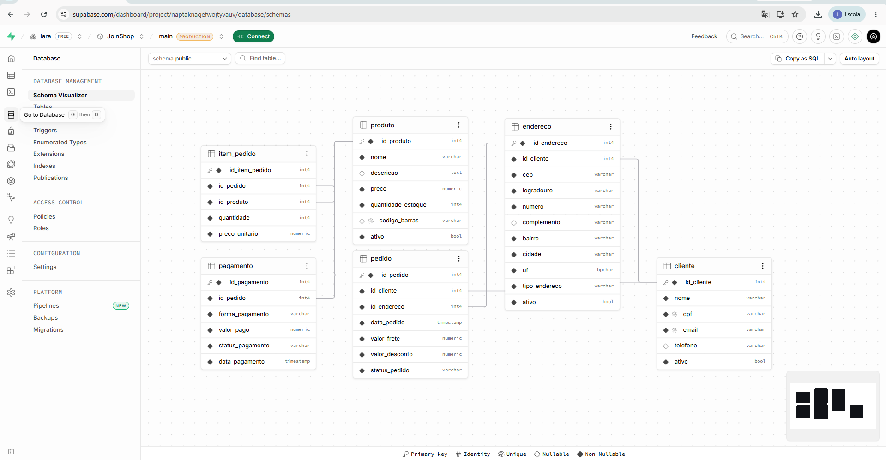
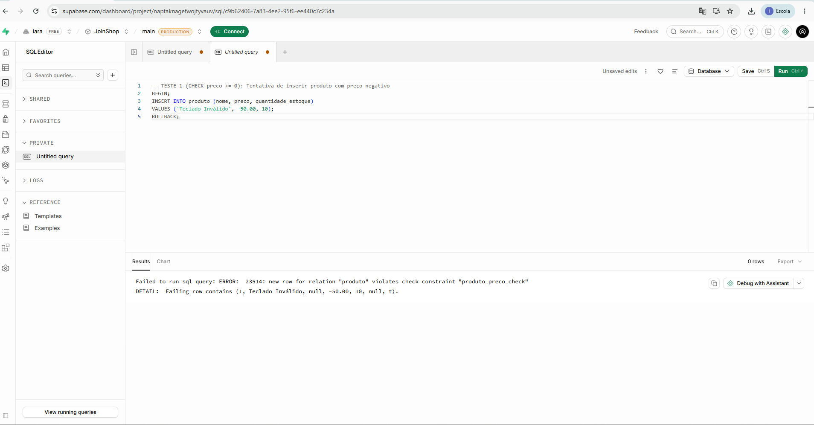
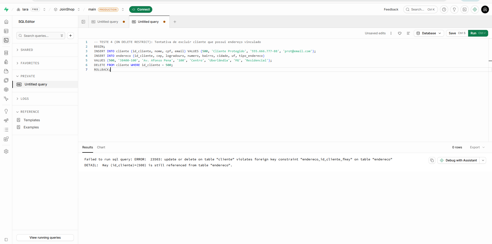

# Projeto Integrador — JoinShop (E-commerce)

Repositório oficial do trabalho final da disciplina de **Banco de Dados** (2º período — Sistemas para Internet). O projeto consiste na modelagem, implementação física e manipulação de um banco de dados relacional para a loja virtual **JoinShop**.

---

## Semanas 1 e 2 — Levantamento de Requisitos, DER e Modelo Lógico

Nas etapas iniciais foram definidos os requisitos do sistema de e-commerce, as regras de negócio, o Diagrama Entidade-Relacionamento (DER) e o Modelo Lógico normalizado.

- **Documentação e Diagramas:** Consulte a pasta [`documentacao/`](documentacao/)
- **Script de Criação (DDL):** [`sql/01_criacao.sql`](sql/01_criacao.sql)

---

## Semana 3 — Implementação Física e Testes de Integridade

Nesta etapa foi realizada a implementação física do banco de dados da **JoinShop** no **Supabase (PostgreSQL)** a partir do script DDL (`01_criacao.sql`), seguida da validação visual do esquema e da execução de testes transacionais (`BEGIN` / `ROLLBACK`) para comprovar a eficácia das restrições de integridade.

### 1. Criação das Tabelas e Estrutura Física

- **Tabelas implementadas (6):** `cliente`, `endereco`, `produto`, `pedido`, `item_pedido` e `pagamento`.

#### Execução do Script no SQL Editor

#### Tabelas Criadas no Table Editor

#### Diagrama Relacional (Schema Visualizer)

### 2. Testes de Integridade e Restrições

Todos os testes foram executados dentro de blocos transacionais (`BEGIN` ... `ROLLBACK`) no SQL Editor do Supabase, garantindo que o banco rejeitasse dados inválidos sem alterar a base limpa.

#### Teste 1 — Restrição `CHECK (preco >= 0)` em `produto`
- **Objetivo:** Impedir o cadastro de produtos com preço negativo (`-50.00`).
- **Resultado obtido:** `ERROR: 23514: new row for relation "produto" violates check constraint "produto_preco_check"`.

#### Teste 2 — Restrição `UNIQUE (cpf)` em `cliente`
- **Objetivo:** Impedir o cadastro de dois clientes distintos utilizando o mesmo CPF (`123.456.789-00`).
- **Resultado obtido:** `ERROR: 23505: duplicate key value violates unique constraint "cliente_cpf_key"`.

#### Teste 3 — Restrição `FOREIGN KEY (id_cliente)` em `endereco`
- **Objetivo:** Impedir o cadastro de um endereço vinculado a um cliente inexistente (`id_cliente = 999`).
- **Resultado obtido:** `ERROR: 23503: insert or update on table "endereco" violates foreign key constraint "endereco_id_cliente_fkey"`.

#### Teste 4 — Restrição `ON DELETE RESTRICT` entre `cliente` e `endereco`
- **Objetivo:** Impedir a exclusão de um cliente (`id_cliente = 500`) que possui endereço vinculado.
- **Resultado obtido:** `ERROR: 23503: update or delete on table "cliente" violates foreign key constraint "endereco_id_cliente_fkey" on table "endereco"`.

#### Teste 5 — Restrição `CHECK (status_pedido)` em `pedido`
- **Objetivo:** Impedir a criação de pedidos com status fora do domínio permitido (`'Status Inexistente'`).
- **Resultado obtido:** `ERROR: 23514: new row for relation "pedido" violates check constraint "pedido_status_pedido_check"`.

