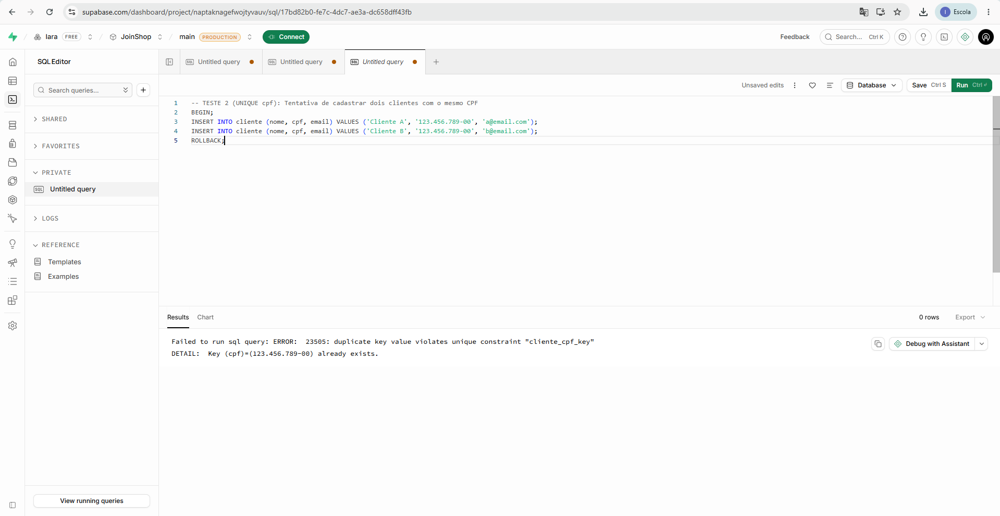
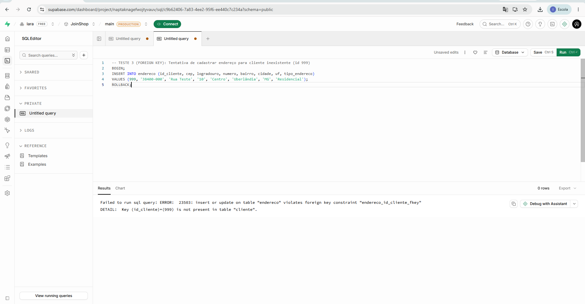
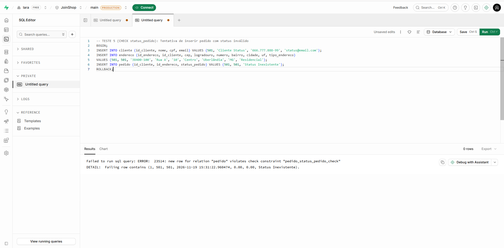
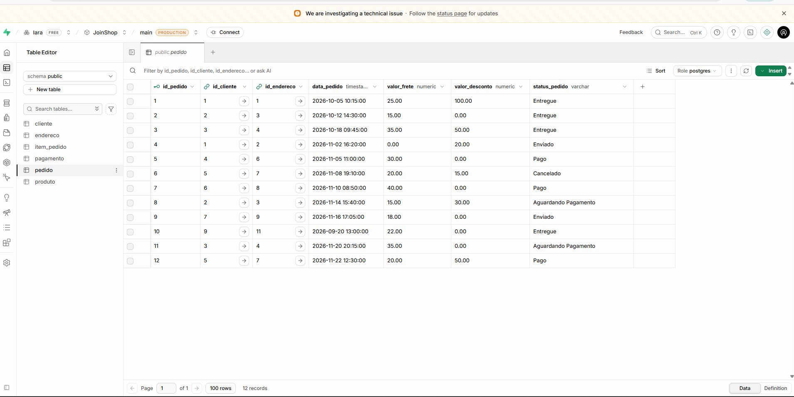
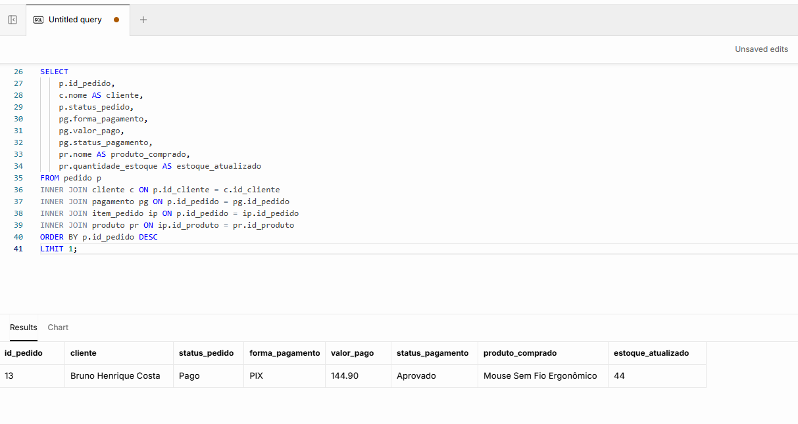

# Projeto Integrador — JoinShop (Loja Virtual)

Repositório oficial do trabalho final da disciplina de **Banco de Dados** (2º período — Sistemas para Internet). O projeto consiste na modelagem, implementação física e manipulação de um banco de dados relacional para a loja virtual **JoinShop** (modelo E-commerce B2C com estoque próprio).

---

## Semanas 1 e 2 — Requisitos, Modelagem Lógica e Normalização

Nas etapas iniciais foram definidos os requisitos do sistema de loja virtual, as regras de negócio, o Diagrama Entidade-Relacionamento (DER) e o Modelo Lógico normalizado.

- **Documentação Completa e Diagramas:** Consulte a pasta [`documentacao/`](documentacao/)
- **Script de Criação (DDL):** [`sql/01_criacao.sql`](sql/01_criacao.sql)

### Principais Regras de Negócio e Modelagem
- **Escopo (Loja Virtual B2C):** Venda direta ao consumidor final com gestão centralizada de catálogo, estoque, pedidos e pagamentos.
- **Cardinalidades e Resolução N:N:** Relacionamentos `1:N` entre `CLIENTE`—`ENDERECO`, `CLIENTE`—`PEDIDO`, `ENDERECO`—`PEDIDO` e `PEDIDO`—`PAGAMENTO`. O relacionamento `N:N` entre `PEDIDO` e `PRODUTO` foi resolvido pela tabela associativa **`ITEM_PEDIDO`**, que também armazena a `quantidade` e o `preco_unitario` histórico da venda.
- **Fluxo de Aprovação e Pagamento:** Um pedido nasce com status `'Aguardando Pagamento'` e a venda só é efetivada (`'Pago'` / `'Confirmado'`) após o registro de um pagamento com `status_pagamento = 'Aprovado'`.
- **Exclusão Lógica e Histórico:** Registros vinculados a vendas são protegidos por `ON DELETE RESTRICT`. A inativação é feita de forma lógica via atributo booleano `ativo` (`TRUE` / `FALSE`) em `cliente`, `endereco` e `produto`.
- **Valores Calculados:** Para evitar redundância, subtotal (`quantidade * preco_unitario`) e valor total (`SUM(subtotal) + valor_frete - valor_desconto`) são calculados dinamicamente em consulta.
- **Normalização (1FN, 2FN e 3FN):** Atributos atomizados e grupos multivalorados separados (1FN); chaves primárias simples eliminando dependências parciais (2FN); ausência de dependências transitivas e de armazenamento de colunas calculadas (3FN).

---

## Semana 3 — Implementação Física e Testes de Integridade

Nesta etapa foi realizada a implementação física do banco de dados da **JoinShop** no **Supabase (PostgreSQL)** a partir do script DDL (`01_criacao.sql`), seguida da validação visual do esquema e da execução de testes transacionais (`BEGIN` / `ROLLBACK`) para comprovar a eficácia das restrições de integridade.

### 1. Criação das Tabelas e Estrutura Física

- **Tabelas implementadas (6):** `cliente`, `endereco`, `produto`, `pedido`, `item_pedido` e `pagamento`.

#### Execução do Script no SQL Editor

#### Tabelas Criadas no Table Editor

#### Diagrama Relacional (Schema Visualizer)

### 2. Testes de Integridade e Restrições

Todos os testes foram executados dentro de blocos transacionais (`BEGIN` ... `ROLLBACK`) no SQL Editor do Supabase, garantindo que o banco rejeitasse dados inválidos sem alterar a base limpa.

#### Teste 1 — Restrição `CHECK (preco >= 0)` em `produto`
- **Objetivo:** Impedir o cadastro de produtos com preço negativo (`-50.00`).
- **Resultado obtido:** `ERROR: 23514: new row for relation "produto" violates check constraint "produto_preco_check"`.

#### Teste 2 — Restrição `UNIQUE (cpf)` em `cliente`
- **Objetivo:** Impedir o cadastro de dois clientes distintos utilizando o mesmo CPF (`123.456.789-00`).
- **Resultado obtido:** `ERROR: 23505: duplicate key value violates unique constraint "cliente_cpf_key"`.

#### Teste 3 — Restrição `FOREIGN KEY (id_cliente)` em `endereco`
- **Objetivo:** Impedir o cadastro de um endereço vinculado a um cliente inexistente (`id_cliente = 999`).
- **Resultado obtido:** `ERROR: 23503: insert or update on table "endereco" violates foreign key constraint "endereco_id_cliente_fkey"`.

#### Teste 4 — Restrição `ON DELETE RESTRICT` entre `cliente` e `endereco`
- **Objetivo:** Impedir a exclusão de um cliente (`id_cliente = 500`) que possui endereço vinculado.
- **Resultado obtido:** `ERROR: 23503: update or delete on table "cliente" violates foreign key constraint "endereco_id_cliente_fkey" on table "endereco"`.

#### Teste 5 — Restrição `CHECK (status_pedido)` em `pedido`
- **Objetivo:** Impedir a criação de pedidos com status fora do domínio permitido (`'Status Inexistente'`).
- **Resultado obtido:** `ERROR: 23514: new row for relation "pedido" violates check constraint "pedido_status_pedido_check"`.

---

## Semana 4 — População de Dados, Consultas SQL e Transações

Nesta etapa final, o banco de dados foi populado com uma massa de dados realista (**73 registros**) e validado por meio de **17 consultas analíticas e operacionais** (incluindo recursos avançados de CTE, View, Transações e análise de desempenho) além de testes completos de manipulação (DML) e atomicidade (`BEGIN` / `COMMIT`).

- **Script de População (DML):** [`sql/02_populacao.sql`](sql/02_populacao.sql)
- **Script de Consultas (DQL e Extras):** [`sql/03_consultas.sql`](sql/03_consultas.sql)
- **Script de Testes e Transações:** [`sql/04_testes.sql`](sql/04_testes.sql)

### 1. Carga Inicial de Dados (73 Registros)

A população inicial contempla **10 clientes** (ativos e inativos), **12 endereços**, **11 produtos** (incluindo itens com estoque zerado e itens sem vendas), **12 pedidos** em todos os status do ciclo de vida, **16 itens de pedido** e **12 registros de pagamento** (incluindo retentativas de pagamento recusado antes da aprovação).

### 2. Consultas Obrigatórias e Avançadas

Foram implementadas e executadas as **12 consultas obrigatórias** (filtros com `WHERE`, ordenação, paginação com `LIMIT`, junções com `INNER JOIN` e `LEFT JOIN`, agregações com `GROUP BY` e `HAVING`, e subconsultas) e **5 consultas extras** cobrindo recursos avançados do PostgreSQL:

- **Consultas Básicas (1 a 3):** Estoque crítico, pedidos recentes em aberto e top 5 produtos mais caros (`evidencias/10` a `12`).
- **Junções (4 a 6):** Histórico de pagamentos aprovados, detalhamento de itens vendidos por cliente e produtos nunca vendidos com `LEFT JOIN` (`evidencias/13` a `15`).
- **Agregações (7 e 8):** Faturamento por forma de pagamento com `GROUP BY` e clientes recorrentes com `HAVING COUNT(*) > 1` (`evidencias/16` e `17`).
- **Subconsultas (9 e 10):** Produtos acima do preço médio do catálogo e clientes sem pedidos realizados (`evidencias/18` e `19`).
- **Consultas de Negócio e Extras (11 a 17):** Valor total por pedido, faturamento líquido no período, ranking de vendas com **CTE (`WITH`)**, criação e consulta da **View (`vw_resumo_pedidos`)**, transação com **`ROLLBACK`** e análise de plano de execução com **`EXPLAIN ANALYZE`** (`evidencias/20` a `26`).

### 3. Testes de Manipulação (DML) e Transação Atômica (`BEGIN` / `COMMIT`)

Para encerrar a validação, o script `04_testes.sql` executou operações controladas de `INSERT`, `UPDATE` e `DELETE` seguidas de uma **transação atômica multi-operação** que cria um novo pedido pago, insere o item vendido, realiza a baixa automática no estoque e registra o pagamento aprovado de forma indivisível:

---

## Integrantes do Grupo

- **Iara Dias**
- **Lázaro Junio**
- **Lívia**
- **Oliver**
- **Vinícius**
